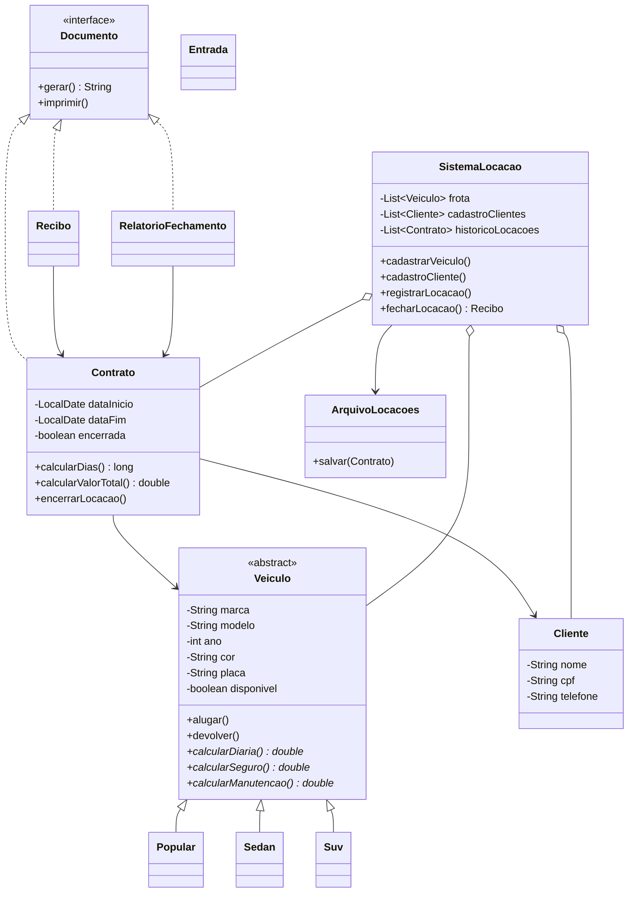

# Rota Segura - Sistema de Locação de Veículos

**Aluno:** Manuella Vieira Acarine
**Matrícula:** Segundo termo

Aplicação de console em Java para gerenciar a locação de veículos: cadastro de veículos e clientes, abertura de locações, devolução, cálculo de valores e emissão de comprovantes.

## 1. Arquitetura

O código-fonte fica em `src/` e é organizado em pacotes:

| Pacote | Classes | Responsabilidade |
|---|---|---|
| `rotasegura` | `Main` | Menu interativo e tratamento final das exceções |
| `rotasegura.modelo` | `Veiculo` (abstrata), `Popular`, `Sedan`, `Suv`, `Cliente`, `Contrato` | Entidades e regras de negócio |
| `rotasegura.documentos` | `Documento` (interface), `Recibo`, `RelatorioFechamento` | Comprovantes emitidos ao fechar a locação |
| `rotasegura.servico` | `SistemaLocacao`, `ArquivoLocacoes` | Cadastros, buscas, registro das locações e gravação do histórico em arquivo |
| `rotasegura.util` | `Entrada` | Leitura e validação dos dados digitados |

### Conceitos de POO aplicados

- **Encapsulamento:** atributos `private` em todas as classes. Os setters de `Veiculo` e `Cliente` validam os dados, e o construtor usa esses setters. O atributo `disponivel` não tem setter: só muda por `alugar()` e `devolver()`. `Contrato` não tem setters. A classe `SistemaLocacao` devolve suas listas como `unmodifiableList`.
- **Herança:** `Popular`, `Sedan` e `Suv` estendem a classe abstrata `Veiculo`, que define os métodos abstratos `calcularDiaria()`, `calcularSeguro()` e `calcularManutencao()`.
- **Polimorfismo:** `Contrato` calcula os valores chamando os métodos de `Veiculo` sem saber o tipo concreto do carro (sobrescrita com `@Override`). Também há polimorfismo pela interface `Documento`, implementada por `Contrato`, `Recibo` e `RelatorioFechamento`.
- **Tipos genéricos:** coleções tipadas em `SistemaLocacao`: `List<Veiculo>`, `List<Cliente>` e `List<Contrato>`.
- **Tratamento de exceções:** `IllegalArgumentException` para dados inválidos e `IllegalStateException` para operações em estado inválido (veículo indisponível, locação já encerrada). `ArquivoLocacoes` converte `IOException` em `RuntimeException`, e `Entrada` converte `NumberFormatException` e `DateTimeParseException` em mensagens claras. O `Main` captura tudo, mostra `[ERRO TRATADO]` e continua executando.

### Diagrama de classes



## 2. Como compilar e executar

**Requisito:** JDK 17 ou superior (testado com JDK 21).

Na pasta raiz do repositório:

**Linux / macOS**
```bash
mkdir -p bin
javac -encoding UTF-8 -d bin $(find src -name "*.java")
java -cp bin rotasegura.Main
```

**Windows (PowerShell)**
```powershell
mkdir bin -Force
javac -encoding UTF-8 -d bin (Get-ChildItem -Recurse src -Filter *.java).FullName
java -cp bin rotasegura.Main
```

Se os acentos aparecerem errados no Windows, rode `chcp 65001` antes de executar.

**Pelo VS Code:** abra a pasta do projeto (com o *Extension Pack for Java*), abra `src/rotasegura/Main.java` e clique em **Run**. Depois clique dentro do terminal, digite o número da opção e aperte Enter.

Ao abrir uma locação, o programa cria (ou atualiza) o arquivo `historico_locacoes.txt` na pasta de onde foi executado.

## 3. Menu

```
1 - Cadastrar veículo
2 - Listar veículos
3 - Cadastrar cliente
4 - Listar clientes
5 - Abrir nova locação
6 - Devolver veículo e fechar locação (recibo)
7 - Listar locações abertas
8 - Carregar dados de exemplo
0 - Sair
```

A opção 8 é um atalho para testes: cadastra 3 veículos (placas `ABC1D23`, `DEF4G56` e `HIJ7K89`) e 1 cliente (CPF `12345678900`).

## 4. Cenários de teste realizados

### Cenário 1: fluxo completo

1. Opção `1`: cadastrar um Sedan (Toyota Corolla 2023, preto, placa `ABC1D23`).
2. Opção `2`: listar. O veículo aparece como `DISPONÍVEL`, com diária de R$150.0.
3. Opção `3`: cadastrar a cliente Maria Souza (CPF `12345678900`).
4. Opção `5`: abrir locação de `2026-10-08` a `2026-10-11`.

```
CONTRATO DE LOCAÇÃO
Cliente: Maria Souza
Veiculo: Corolla
Data de inicio: 2026-10-08
Data de fim: 2026-10-11
Valor total: R$675.0
```

5. Opção `7`: a locação aparece na lista de abertas.
6. Opção `6`, locação `1`: devolução e fechamento.

```
RECIBO DE LOCAÇÃO
Cliente: Maria Souza
Veiculo: Corolla
Dias: 3
Valor das diarias: R$450.0
Seguro: R$90.0
Manutenção: R$135.0
Total: R$675.0
```

7. Opção `2`: o veículo volta a aparecer como `DISPONÍVEL`.

### Cenário 2: veículo ocupado

Com a locação do cenário 1 ainda aberta, repetir a opção `5` com a mesma placa:

```
[ERRO TRATADO] O veivulo esta indisponivel
```

### Cenário 3: datas inválidas

- Data final anterior à inicial: `[ERRO TRATADO] A data final não pode ser anterior a data incial`
- Data fora do formato (`08/10/2026`): `[ERRO TRATADO] Data invalida. Use o formato AAAA-MM-DD`

### Cenário 4: outros erros tratados

- Fechar locação sem nenhuma aberta: `[ERRO TRATADO] Não há locações abertas`
- Digitar texto onde se espera número: `[ERRO TRATADO] Digite um numero inteiro valido`
- Deixar um campo vazio: `[ERRO TRATADO] O campo não pode ficar vazio`
- CPF ou placa inexistente na locação: `Cliente nao encontrado` / `Veiculo nao encontrado`
- Cadastrar placa ou CPF repetido: `Ja existe um veiculo com essa placa` / `Ja existe um cliente com esse CPF`

Em todos os casos o programa não é encerrado: volta ao menu.
